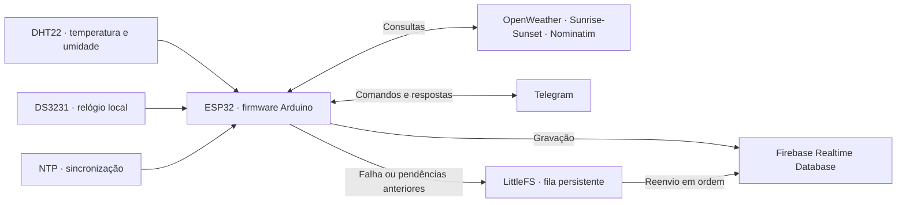

# Estação climática ESP32

**Clima local, horários solares e consultas pelo Telegram, com histórico no Firebase.**

Uma estação climática desenvolvida em Arduino C++ para ESP32. O DHT22 mede temperatura e umidade no local da instalação, enquanto o DS3231 mantém o relógio da estação. Pela rede Wi-Fi, o firmware sincroniza o horário, consulta serviços de clima e eventos solares, responde a mensagens no Telegram e registra dados no Firebase Realtime Database.

Quando uma gravação falha, uma fila persistente no LittleFS permite tentar novamente sem descartar as pendências antigas.

[Funcionalidades](#funcionalidades) · [Funcionamento](#como-funciona) · [Hardware](#hardware) · [Instalação](#instalação-e-configuração) · [Telegram](#usando-o-telegram) · [Diagnóstico](#diagnóstico)

## Funcionalidades

| Recurso | O que o projeto faz |
| --- | --- |
| Clima da estação | Mede temperatura, umidade e calcula a sensação térmica a partir do DHT22. |
| Relógio local | Usa o RTC DS3231 e ajusta o horário pela rede via NTP. |
| Eventos solares | Consulta nascer e pôr do sol, amanhecer astronômico, zênite e anoitecer astronômico. |
| Bot Telegram | Responde a consultas da estação e a pesquisas por CEP ou localização compartilhada. |
| Controle de acesso | Separa comandos da estação para IDs autorizados e consultas de localização para visitantes. |
| Histórico remoto | Registra clima e dados solares no Firebase Realtime Database. |
| Persistência local | Enfileira gravações pendentes em LittleFS e tenta reenviá-las em ordem. |
| Alerta matinal | Envia aos IDs configurados uma mensagem 15 minutos após o amanhecer astronômico, quando os dados solares estão disponíveis. |

## Como funciona



Na inicialização, o firmware prepara os sensores, conecta o Wi-Fi, tenta sincronizar o RTC, inicializa o Firebase e a fila local, consulta os horários solares e realiza a primeira leitura do DHT22.

Depois, o `loop()` mantém a conexão e executa as tarefas abaixo:

| Rotina | Comportamento configurado |
| --- | --- |
| Histórico de clima | Nova leitura do DHT22 e tentativa de gravação na hora cheia, em operação normal. |
| Atualização solar | Consulta na inicialização e atualização diária às **04:30**, pelo relógio da estação. A gravação diária depende do sucesso das duas APIs solares. |
| Alerta matinal | Verifica o horário de amanhecer e tenta enviar a mensagem 15 minutos depois. |
| Sincronização do RTC | Tenta sincronizar no início e a cada 10 minutos após uma sincronização bem-sucedida. |
| Telegram | Consulta mensagens com intervalo de aproximadamente 1 segundo, sujeito ao tempo das chamadas de rede. |
| Reconexão Wi-Fi | Nova tentativa após intervalo de 30 segundos; cada tentativa aguarda até 15 segundos. |
| Fila Firebase | Processa um registro por tentativa, com espera entre tentativas de 5 segundos a 5 minutos após falhas. |

O relógio da estação está configurado para **UTC−3**. Consultas por CEP ou localização usam o deslocamento de fuso retornado pelo OpenWeather para aquela coordenada.

**Duas fontes de clima:** os comandos `clima` e `status` usam a leitura do **DHT22 da estação**. As consultas por CEP ou localização usam os dados do **OpenWeather para o lugar solicitado**, sem alterar a localização fixa da estação.

## Hardware

Os componentes e sinais abaixo foram identificados no firmware:

| Componente | Função | Ligação definida no código |
| --- | --- | --- |
| ESP32 | Executa o firmware e acessa a rede Wi-Fi. | Alvo de compilação: `esp32:esp32:esp32` — ESP32 Dev Module. |
| DHT22 | Mede temperatura e umidade. | Sinal no **GPIO 4**; `DHT_PIN = 4`, `DHT_TYPE = DHT22`. |
| DS3231 | Mantém data e hora. | Barramento I²C, inicializado com `Wire.begin()`. |

O modelo físico exato do ESP32 e o esquema elétrico não estão documentados. O código não define SDA/SCL explicitamente; confira os pinos padrão da placa escolhida. Alimentação, resistores e demais ligações precisam ser conferidos para os módulos realmente utilizados.

O RTC é necessário para a inicialização: se o DS3231 não for detectado, o firmware permanece aguardando e informa o problema na serial.

## Instalação e configuração

### 1. Obtenha o projeto

Clone para uma pasta chamada `estacao_climatica`, mantendo o nome esperado pelo sketch Arduino:

```sh
git clone https://github.com/anvmano/estacao-climatica.git estacao_climatica
cd estacao_climatica
```

Todos os arquivos `.ino` devem permanecer juntos nessa pasta.

### 2. Prepare o ambiente Arduino

Use Arduino IDE ou Arduino CLI e instale o pacote **esp32 by Espressif Systems**. A versão usada na compilação verificada foi **2.0.14**, com a placa **ESP32 Dev Module**.

Instale também as bibliotecas abaixo pelo gerenciador de bibliotecas. As versões indicam o ambiente local utilizado na verificação, não uma garantia de compatibilidade com outras versões.

| Biblioteca | Versão verificada | Finalidade |
| --- | --- | --- |
| ArduinoJson | 7.4.3 | Leitura e escrita de JSON; o firmware utiliza `JsonDocument`. |
| DHT sensor library — Adafruit | 1.4.7 | Comunicação com o DHT22. |
| Adafruit Unified Sensor | 1.1.15 | Dependência da biblioteca do DHT. |
| RTClib — Adafruit | 2.1.4 | Comunicação com o DS3231. |
| Adafruit BusIO | 1.17.4 | Dependência da RTClib. |
| Firebase ESP32 Client — Mobizt | 4.4.17 | Cliente que fornece `FirebaseESP32.h`. |
| UniversalTelegramBot | 1.3.0 | Integração com o bot Telegram. |
| NTPClient | 3.2.1 | Sincronização de horário pela rede. |

`WiFi`, `WiFiClientSecure`, `WiFiUdp`, `HTTPClient`, `Wire`, `LittleFS` e `Preferences` são fornecidas pelo pacote ESP32. Selecione um esquema de partições com espaço para LittleFS; o firmware usa a partição com rótulo `spiffs`.

### 3. Crie sua configuração local

O repositório distribui apenas [secrets.example.h](secrets.example.h), com placeholders. Crie o arquivo local `secrets.h` a partir dele.

**PowerShell:**

```powershell
Copy-Item secrets.example.h secrets.h
```

**Linux/macOS:**

```sh
cp secrets.example.h secrets.h
```

Preencha os valores no seu `secrets.h`:

| Variável | O que configurar |
| --- | --- |
| `WIFI_SSID` | Nome da rede Wi-Fi. |
| `WIFI_PASSWORD` | Senha da rede. |
| `OPENWEATHER_API_KEY` | Chave da sua conta OpenWeather. |
| `BOT_TOKEN` | Token do bot Telegram criado por você no BotFather. |
| `VALID_SENDER_IDS` | IDs dos usuários Telegram autorizados, como strings. Ajuste a lista aos seus usuários. |
| `FIREBASE_HOST` | URL do seu Firebase Realtime Database. |
| `FIREBASE_AUTH` | Token legado do banco, conforme o mecanismo utilizado pelo firmware. |
| `DEFAULT_LATITUDE` | Latitude da estação em graus decimais. |
| `DEFAULT_LONGITUDE` | Longitude da estação em graus decimais. |
| `DEFAULT_ALTITUDE` | Altitude da estação; o campo é preservado na estrutura de localização. |

`VALID_SENDER_ID_COUNT` é calculado automaticamente a partir da lista. Os valores `0.0` de localização no exemplo são placeholders e devem ser substituídos pelos dados da sua instalação.

Para o Firebase, configure seu próprio Realtime Database e as permissões de escrita para a autenticação utilizada. O código atribui `FIREBASE_AUTH` a `configFirebase.signer.tokens.legacy_token`; esse campo não é uma chave de API web nem um arquivo de conta de serviço.

OpenWeather, Telegram e Firebase exigem configuração da sua conta. Sunrise-Sunset, Nominatim/OpenStreetMap e NTP são acessados pelos endpoints definidos no sketch, sem credenciais específicas nele.

`secrets.h` está no `.gitignore`. Mantenha os valores reais somente nesse arquivo local, preserve o exemplo com placeholders e não force a inclusão de arquivos ignorados. SSID, senha, tokens, IDs pessoais e localização real não fazem parte da publicação.

### 4. Compile e grave

**Arduino IDE**

1. Abra `estacao_climatica.ino`.
2. Selecione a placa correspondente ao seu hardware. Para reproduzir o alvo verificado, use **ESP32 Dev Module**.
3. Confira o esquema de partições com LittleFS e selecione a porta da placa.
4. Verifique/compile o sketch e faça o upload.
5. Abra o monitor serial a **9600 baud**.

**Arduino CLI**, com o core, as bibliotecas e `secrets.h` já preparados:

```sh
arduino-cli compile --fqbn esp32:esp32:esp32 .
```

Para gravar, substitua `SUA_PORTA` pela porta real da placa:

```sh
arduino-cli board list
arduino-cli upload --fqbn esp32:esp32:esp32 --port SUA_PORTA .
arduino-cli monitor --port SUA_PORTA --config baudrate=9600
```

### 5. Confira a primeira execução

Acompanhe a serial para verificar a detecção do RTC, a conexão Wi-Fi, a inicialização do Firebase/LittleFS e as leituras do DHT22. Depois, abra uma conversa com seu bot e envie `/start`.

A primeira leitura não implica uma gravação imediata no Firebase: em operação normal, o histórico de clima é registrado na hora cheia e os dados solares na rotina diária das 04:30.

## Usando o Telegram

Envie os textos conforme a tabela, sem acentos nos comandos. Os atalhos de `1` a `4` são exclusivos dos usuários autorizados; `5` também é aceito para solicitar localização a visitantes.

| Mensagem | Atalho | Quem pode usar | Resposta ou ação |
| --- | --- | --- | --- |
| `/start` | — | Todos | Apresenta o menu disponível para o remetente. |
| `nascer do sol` | `1` | Autorizados | Horário de nascer do sol da estação. |
| `por do sol` | `2` | Autorizados | Horário de pôr do sol da estação. |
| `clima` | `3` | Autorizados | Atualiza a leitura do DHT22 e informa temperatura, umidade e sensação térmica. |
| `status` | `4` | Autorizados | Resumo dos horários solares e do clima local. |
| `localizacao` | `5` | Todos | Solicita o compartilhamento da localização para consultar clima e horários solares. |
| CEP com 8 dígitos, com ou sem hífen | — | Todos | Busca coordenadas pelo Nominatim e consulta os dados do local. |
| Localização compartilhada no Telegram | — | Todos | Consulta o lugar recebido, mesmo sem um pedido prévio de localização. |

Para consultar um CEP, envie os oito dígitos, com ou sem hífen. A palavra `CEP` isolada não inicia a pesquisa.

A autorização compara o **ID do remetente** com `VALID_SENDER_IDS`. Visitantes podem consultar lugares por CEP ou localização, mas não recebem os comandos de clima/status da estação. O alerta matinal é enviado aos IDs configurados na lista.

A consulta por CEP usa o primeiro resultado do Nominatim, limitado ao Brasil. O firmware não confirma cidade/UF nem a precisão do CEP retornado; para uma consulta mais precisa, compartilhe a localização pelo Telegram.

## Histórico no Firebase

As gravações usam destinos determinísticos e `setJSON()`: tentar enviar novamente a mesma operação sobrescreve seu destino, evitando criar um novo registro a cada tentativa.

```text
historico/
├── Temperatura/
│   └── DD-MM-AAAA/
│       └── HH-MM/
│           └── clima/
│               ├── Temperatura
│               ├── Umidade
│               └── Sensacao termica
└── NascePorDoSol/
    └── DD-MM-AAAA/
        └── solar/
            ├── HoraPorDoSol
            ├── MinutePorDoSol
            ├── HourNascerDoSol
            ├── MinuteNascerDoSol
            ├── HoraAmanhecer
            ├── MinuteAmanhecer
            ├── HoraZenite
            ├── MinuteZenite
            ├── HourAnoitecer
            └── MinuteAnoitecer
```

Os nomes acima são os campos efetivamente gravados pelo firmware, incluindo espaços e a mistura de nomes em português e inglês. Consumidores do banco devem respeitar esse formato. Temperatura e sensação térmica são expressas em °C; umidade, em %.

### Quando a rede ou o Firebase falham

A fila LittleFS preserva as operações pendentes, tenta reenviá-las em ordem e remove cada arquivo somente após confirmação de gravação. Há recuperação de um arquivo temporário válido após reinício.

O limite configurado para a fila é **256 KiB**, sujeito também ao espaço disponível na partição. Quando não consegue preservar uma nova operação, o firmware registra um erro crítico na serial e mantém as pendências antigas. Uma fila já inicializada não é formatada automaticamente quando a montagem falha.

A fila guarda gravações que foram produzidas; ela não recupera retroativamente medições que deixaram de ser coletadas nem oferece armazenamento ilimitado.

## Diagnóstico

Com `DEBUG_SERIAL = 1`, o monitor serial mostra informações de conexão, relógio, leituras e fila a **9600 baud**, incluindo um resumo `[DIAG]` a cada 5 segundos.

| Sintoma | O que conferir |
| --- | --- |
| `secrets.h: No such file or directory` | Crie `secrets.h` copiando o arquivo de exemplo para a mesma pasta do sketch. |
| Falta de `DHT.h`, `RTClib.h`, `FirebaseESP32.h` ou outra biblioteca | Confira a instalação das bibliotecas e do pacote ESP32 listados acima. |
| Erros envolvendo `JsonDocument` | Confira o uso do ArduinoJson 7, conforme a versão verificada. |
| `Nao foi possivel encontrar o RTC.` | Confira o DS3231, sua alimentação e o barramento I²C da placa. Essa condição impede a continuação da inicialização. |
| Wi-Fi não conecta | Confira SSID/senha no arquivo local e acompanhe as novas tentativas na serial. |
| `Falha ao ler o sensor DHT.` | Confira o DHT22, sua alimentação e o sinal no GPIO 4. Uma leitura inválida não gera um novo registro de clima. |
| Firebase não recebe dados | Confira URL, token legado e permissões do banco. Observe os horários de gravação e as mensagens `[FIREBASE]` e `[FILA]`. |
| Bot mostra apenas o menu de visitante | Confira se o ID do remetente está em `VALID_SENDER_IDS`, como string. |
| CEP não encontrado ou lugar impreciso | Envie a localização pelo Telegram; a consulta por CEP depende do primeiro resultado do Nominatim. |
| Horários solares indisponíveis | Confira a rede e a chave OpenWeather. Uma falha no início só é tentada novamente pela rotina diária. |
| Fila cheia ou falha de LittleFS | Confira o esquema de partições e o diagnóstico da fila. Preserve os dados pendentes ao investigar. |

Os logs de conexão podem mostrar SSID e IP local. Remova essas informações antes de compartilhar uma captura do monitor serial.

## Compilação verificada e limites

A publicação inicial foi compilada com **Arduino CLI 1.5.1**, core ESP32 **2.0.14**, alvo `esp32:esp32:esp32` e credenciais substituídas por placeholders:

| Recurso | Resultado |
| --- | --- |
| Compilação | Concluída com sucesso. |
| Flash da aplicação | 1.283.285 de 1.310.720 bytes — **97%**. |
| RAM global | 49.804 de 327.680 bytes — **15%**. |
| Teste em placa e serviços reais | Não realizado nessa verificação. |

A margem de flash é pequena no esquema de partições utilizado. Mudanças de core, bibliotecas ou funcionalidades podem alterar o tamanho do binário.

Chamadas HTTP, Firebase e Telegram podem bloquear durante requisições; os intervalos de agendamento não garantem execução em tempo real. O cliente HTTPS das APIs utiliza `setInsecure()`; o cliente Telegram configura um certificado raiz. Esses comportamentos refletem o firmware atual.

## Organização do projeto

| Arquivo | Responsabilidade |
| --- | --- |
| [estacao_climatica.ino](estacao_climatica.ino) | Constantes, estruturas, objetos globais, `setup()` e `loop()`. |
| [01_Utils.ino](01_Utils.ino) | Formatação, validações, URLs e conversões de horário/fuso. |
| [02_Connectivity.ino](02_Connectivity.ino) | Wi-Fi, TLS, RTC e sincronização NTP. |
| [03_Sensors.ino](03_Sensors.ino) | Leitura e validação do DHT22. |
| [04_WeatherAndSun.ino](04_WeatherAndSun.ino) | Consultas ao OpenWeather e Sunrise-Sunset. |
| [05_Firebase.ino](05_Firebase.ino) | Inicialização do cliente e gravações no banco. |
| [06_Telegram.ino](06_Telegram.ino) | Comandos, permissões, localização, CEP e alerta matinal. |
| [07_Tasks.ino](07_Tasks.ino) | Agendamento das tarefas de clima e eventos solares. |
| [08_FirebaseQueue.ino](08_FirebaseQueue.ino) | Fila persistente, recuperação e reenvio de pendências. |
| [secrets.example.h](secrets.example.h) | Modelo da configuração local, sem credenciais reais. |

### Documentação técnica

- [Arquitetura](docs/ARCHITECTURE_AI.md): componentes, fluxos e responsabilidades.
- [Regras de negócio](docs/BUSINESS_RULES.md): condições de leitura, gravação, consultas e alertas.
- [Mapa de dependências](docs/DEPENDENCY_MAP.md): relações entre módulos, bibliotecas e serviços.
- [Contexto rápido](docs/AI_QUICK_CONTEXT.md): visão geral para manutenção.
- [Orientações para manutenção assistida](docs/AI_SYSTEM_PROMPT.md): contexto e cuidados para alterações no firmware.
