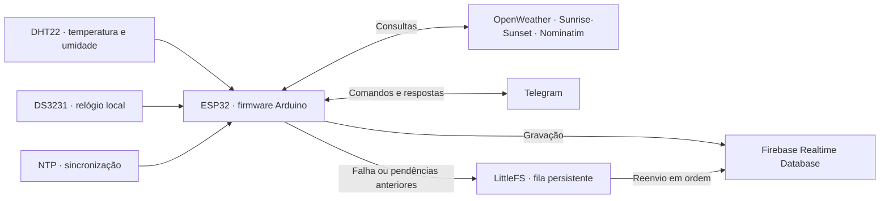

# Estação climática ESP32

**Clima local, horários solares e consultas pelo Telegram, com histórico no Firebase.**

Uma estação climática desenvolvida em Arduino C++ para ESP32. O DHT22 mede temperatura e umidade no local da instalação, enquanto o DS3231 mantém o relógio da estação. Pela rede Wi-Fi, o firmware sincroniza o horário, consulta serviços de clima e eventos solares, responde a mensagens no Telegram e registra dados no Firebase Realtime Database.

Quando uma gravação falha, uma fila persistente no LittleFS permite tentar novamente sem descartar as pendências antigas.

## Conteúdo

- [Funcionalidades](#funcionalidades)
- [Como funciona](#como-funciona)
- [Hardware e pinagem](#hardware-e-pinagem)
- [Requisitos e dependências](#requisitos-e-dependências)
- [Instalação e configuração](#instalação-e-configuração)
- [Operação](#operação)
- [Dados e integrações](#dados-e-integrações)
- [Configurações e calibração](#configurações-e-calibração)
- [Falhas e recuperação](#falhas-e-recuperação)
- [Diagnóstico](#diagnóstico)
- [Estrutura do projeto](#estrutura-do-projeto)
- [Validação e limitações](#validação-e-limitações)
- [Documentação complementar](#documentação-complementar)

## Funcionalidades

| Recurso | Comportamento implementado |
| --- | --- |
| Clima da estação | Mede temperatura, umidade e calcula a sensação térmica a partir do DHT22. |
| Relógio local | Usa o RTC DS3231 e ajusta o horário pela rede via NTP. |
| Eventos solares | Consulta nascer e pôr do sol, amanhecer astronômico, zênite e anoitecer astronômico. |
| Bot Telegram | Responde a consultas da estação e a pesquisas por CEP ou localização compartilhada. |
| Controle de acesso | Separa comandos da estação para IDs autorizados e consultas de localização para visitantes. |
| Histórico remoto | Registra clima e dados solares no Firebase Realtime Database. |
| Persistência local | Enfileira gravações pendentes em LittleFS e tenta reenviá-las em ordem. |
| Alerta matinal | Tenta enviar aos IDs configurados uma mensagem 15 minutos após o amanhecer astronômico, quando os dados solares estão disponíveis. |

## Como funciona



Na inicialização, o firmware prepara os sensores, conecta o Wi-Fi, tenta sincronizar o RTC, inicializa o Firebase e a fila local, consulta os horários solares e realiza a primeira leitura do DHT22.

O `loop()` tenta manter o Wi-Fi, sincroniza o relógio, processa a fila Firebase, executa as tarefas agendadas e consulta mensagens do Telegram. Os intervalos e as condições de execução estão em [Operação](#operação).

## Hardware e pinagem

O alvo usado na compilação verificada é **ESP32 Dev Module**, identificado por `esp32:esp32:esp32`. Isso identifica a configuração de compilação; o modelo físico exato da placa não está documentado.

| Componente | Função | Pino no código | GPIO ou interface | Observação |
| --- | --- | --- | --- | --- |
| ESP32 | Executa o firmware e acessa o Wi-Fi. | — | Wi-Fi e periféricos do core ESP32. | Modelo físico não confirmado. |
| DHT22 | Mede temperatura e umidade. | `DHT_PIN = 4` | **GPIO 4** | `DHT_TYPE = DHT22`. |
| DS3231 | Mantém data e hora. | `Wire.begin()` | I²C; SDA/SCL padrão da placa selecionada. | O código não define os pinos explicitamente. |

O repositório não contém esquema elétrico completo nem especificações de alimentação, resistores ou módulos utilizados. Confira essas ligações e os pinos I²C para o hardware real antes da gravação.

O RTC é necessário para a inicialização: se o DS3231 não for detectado, o firmware permanece aguardando e informa o problema na serial.

## Requisitos e dependências

Para obter e compilar o projeto, use Git e Arduino IDE ou Arduino CLI. A compilação pode ser feita sem placa conectada. Para operar a estação, são necessários o hardware, uma rede Wi-Fi e a configuração dos serviços descritos abaixo.

As versões da tabela foram usadas na compilação da publicação inicial. São uma referência de ambiente verificado, não uma garantia de compatibilidade com outras versões.

| Dependência | Versão de referência | Uso | Evidência da versão |
| --- | --- | --- | --- |
| Core ESP32 (`esp32:esp32`) | 2.0.14 | Placa, Wi-Fi, HTTP/TLS, I²C, LittleFS e Preferences. | Compilação da publicação inicial. |
| ArduinoJson | 7.4.3 | Leitura e escrita de JSON; utiliza `JsonDocument`. | Compilação da publicação inicial. |
| DHT sensor library — Adafruit | 1.4.7 | Comunicação com o DHT22. | Compilação da publicação inicial. |
| Adafruit Unified Sensor | 1.1.15 | Dependência da biblioteca do DHT. | Compilação da publicação inicial. |
| RTClib — Adafruit | 2.1.4 | Comunicação com o DS3231. | Compilação da publicação inicial. |
| Adafruit BusIO | 1.17.4 | Dependência da RTClib. | Compilação da publicação inicial. |
| Firebase ESP32 Client — Mobizt | 4.4.17 | Cliente que fornece `FirebaseESP32.h`. | Compilação da publicação inicial. |
| UniversalTelegramBot | 1.3.0 | Integração com o bot Telegram. | Compilação da publicação inicial. |
| NTPClient | 3.2.1 | Sincronização do relógio pela rede. | Compilação da publicação inicial. |

`WiFi`, `WiFiClientSecure`, `WiFiUdp`, `HTTPClient`, `Wire`, `LittleFS` e `Preferences` acompanham o pacote ESP32. O acesso ao Firebase utiliza a biblioteca **Firebase ESP32 Client**, não um cliente REST implementado diretamente no sketch.

## Instalação e configuração

### 1. Obter o projeto

Clone para uma pasta chamada `estacao_climatica`, correspondente ao sketch principal:

```powershell
git clone https://github.com/anvmano/estacao-climatica.git estacao_climatica
Set-Location -LiteralPath 'estacao_climatica'
```

Todos os arquivos `.ino` devem permanecer juntos nessa pasta. Abra `estacao_climatica.ino` na Arduino IDE.

### 2. Preparar as dependências

**Arduino IDE:** adicione o índice estável de placas às URLs adicionais do Gerenciador de Placas, seguindo o [guia oficial da Espressif](https://docs.espressif.com/projects/arduino-esp32/en/latest/installing.html). Instale **esp32 by Espressif Systems 2.0.14**, selecione **ESP32 Dev Module** e instale as bibliotecas nas versões da tabela pelo Gerenciador de Bibliotecas.

**Arduino CLI — PowerShell:**

```powershell
$esp32Index = 'https://espressif.github.io/arduino-esp32/package_esp32_index.json'
arduino-cli core update-index --additional-urls $esp32Index
arduino-cli core install esp32:esp32@2.0.14 --additional-urls $esp32Index
arduino-cli lib update-index
arduino-cli lib install "ArduinoJson@7.4.3" "DHT sensor library@1.4.7"
arduino-cli lib install "Adafruit Unified Sensor@1.1.15" "Adafruit BusIO@1.17.4"
arduino-cli lib install "RTClib@2.1.4" "Firebase ESP32 Client@4.4.17"
arduino-cli lib install "UniversalTelegramBot@1.3.0" "NTPClient@3.2.1"
```

### 3. Configurar credenciais e serviços

O repositório distribui [secrets.example.h](secrets.example.h) com placeholders. Crie o arquivo local `secrets.h` somente se ele ainda não existir:

```powershell
if (-not (Test-Path -LiteralPath 'secrets.h')) {
    Copy-Item -LiteralPath 'secrets.example.h' -Destination 'secrets.h'
}
```

Em Linux/macOS, preserve também um arquivo já configurado:

```sh
if [ ! -e secrets.h ]; then
    cp -n secrets.example.h secrets.h
fi
```

Edite os valores no seu `secrets.h`, preservando os nomes e as declarações do exemplo:

| Identificador real | O que preencher | Formato ou condição |
| --- | --- | --- |
| `WIFI_SSID` | Nome da rede Wi-Fi. | String. |
| `WIFI_PASSWORD` | Senha da rede. | String. |
| `OPENWEATHER_API_KEY` | Chave da sua conta OpenWeather. | String usada nas consultas à API. |
| `BOT_TOKEN` | Token do bot criado por você no BotFather. | String usada pelo cliente Telegram. |
| `VALID_SENDER_IDS` | IDs dos usuários Telegram autorizados. | Lista de strings; ajuste a lista aos seus usuários. |
| `FIREBASE_HOST` | URL do seu Firebase Realtime Database. | String atribuída a `configFirebase.database_url`. |
| `FIREBASE_AUTH` | Token legado do banco. | Atribuído a `configFirebase.signer.tokens.legacy_token`. |
| `DEFAULT_LATITUDE` | Latitude da estação. | `double`, em graus decimais. |
| `DEFAULT_LONGITUDE` | Longitude da estação. | `double`, em graus decimais. |
| `DEFAULT_ALTITUDE` | Altitude da estação. | `double`; campo preservado na estrutura de localização. |

`VALID_SENDER_ID_COUNT` é calculado automaticamente a partir da lista. Os valores `0.0` de localização do exemplo são placeholders e devem ser substituídos pelos dados da sua instalação.

Use **Realtime Database** e configure as permissões para gravar nos caminhos de histórico documentados em [Dados e integrações](#dados-e-integrações). O mecanismo implementado utiliza token legado; `FIREBASE_AUTH` não é uma chave de API web nem um arquivo de conta de serviço. O sketch não implementa provisionamento de usuários ou renovação de credenciais.

OpenWeather, Telegram e Firebase exigem configuração da sua conta. Sunrise-Sunset, Nominatim/OpenStreetMap e NTP são acessados pelos endpoints definidos no sketch, sem credenciais específicas nele. Não é necessário tornar o banco público para usar o firmware.

`secrets.h` é ignorado pelo [.gitignore](.gitignore). Mantenha os valores reais somente nesse arquivo local, preserve o exemplo com placeholders e não force a inclusão de arquivos ignorados. SSID, senha, tokens, IDs pessoais e localização real não fazem parte da publicação.

### 4. Compilar e gravar

Na **Arduino IDE**, confirme a placa e as bibliotecas e use **Verificar**. Selecione um esquema de partições com espaço para LittleFS: o firmware usa a partição com rótulo `spiffs`. A compilação inicial utilizou a configuração padrão do alvo.

Com a **Arduino CLI**, execute na pasta do sketch, após criar `secrets.h` e instalar as dependências:

```powershell
arduino-cli compile --warnings all --fqbn esp32:esp32:esp32 --build-path build .
```

Conecte a placa, identifique sua porta e substitua `SUA_PORTA` pelo valor correspondente:

```powershell
arduino-cli board list
arduino-cli upload --fqbn esp32:esp32:esp32 --port SUA_PORTA --input-dir build .
arduino-cli monitor --port SUA_PORTA --config baudrate=9600
```

O upload usa os binários da compilação anterior em `build/`; ele não compila o sketch. Na IDE, selecione a porta, use **Carregar** e abra o monitor serial em **9600 baud**. Gravar e validar o funcionamento exige a placa física.

A pasta `build/` é ignorada pelo Git. Os binários contêm os valores da configuração local e não devem ser publicados.

## Operação

### Primeira execução

Acompanhe a serial para verificar a detecção do RTC, a conexão Wi-Fi, a inicialização do Firebase/LittleFS e as leituras do DHT22. Se o RTC perdeu energia, o firmware aplica a data/hora da compilação antes de tentar o ajuste por NTP. Depois, abra uma conversa com seu bot e envie `/start`.

A primeira leitura não implica uma gravação imediata no Firebase: em operação normal, o histórico de clima é registrado na hora cheia e os dados solares na rotina diária das 04:30.

### Rotina de funcionamento

| Evento ou condição | Comportamento configurado |
| --- | --- |
| Histórico de clima | Nova leitura do DHT22 e tentativa de gravação na hora cheia, em operação normal. |
| Atualização solar | Consulta na inicialização e atualização diária às **04:30**, pelo relógio da estação. A gravação diária depende do sucesso das duas APIs solares. |
| Alerta matinal | Verifica o horário de amanhecer e tenta enviar a mensagem 15 minutos depois. |
| Sincronização do RTC | Tenta sincronizar no início e a cada 10 minutos após uma sincronização bem-sucedida. |
| Telegram | Consulta mensagens com intervalo de aproximadamente 1 segundo, sujeito ao tempo das chamadas de rede. |
| Reconexão Wi-Fi | Nova tentativa após intervalo de 30 segundos; cada tentativa aguarda até 15 segundos. |
| Fila Firebase | Processa um registro por tentativa, com espera entre tentativas de 5 segundos a 5 minutos após falhas. |

O relógio da estação está configurado para **UTC−3**. Consultas por CEP ou localização usam o deslocamento de fuso retornado pelo OpenWeather para aquela coordenada.

Esses horários são condições de agendamento; leituras e chamadas de rede podem atrasar o `loop()`. A agenda do firmware não garante execução em tempo real.

### Comandos e permissões do Telegram

Envie os textos conforme a tabela, sem acentos nos comandos. Os atalhos de `1` a `4` são exclusivos dos usuários autorizados; `5` também é aceito para solicitar localização a visitantes.

| Mensagem | Atalho | Quem pode usar | Resposta ou ação |
| --- | --- | --- | --- |
| `/start` | — | Todos | Apresenta o menu disponível para o remetente. |
| `nascer do sol` | `1` | Autorizados | Horário de nascer do sol da estação. |
| `por do sol` | `2` | Autorizados | Horário de pôr do sol da estação. |
| `clima` | `3` | Autorizados | Atualiza a leitura do DHT22 e informa temperatura, umidade e sensação térmica. |
| `status` | `4` | Autorizados | Resumo dos horários solares e do clima local. |
| `localizacao` | `5` | Todos | Solicita o compartilhamento da localização para consultar clima e horários solares. |
| CEP com 8 dígitos, com ou sem hífen | — | Todos | Busca coordenadas pelo Nominatim e consulta os dados do local. |
| Localização compartilhada no Telegram | — | Todos | Consulta o lugar recebido, mesmo sem um pedido prévio de localização. |

Para consultar um CEP, envie os oito dígitos, com ou sem hífen. A palavra `CEP` isolada não inicia a pesquisa.

A autorização compara o **ID do remetente** com `VALID_SENDER_IDS`. Visitantes podem consultar lugares por CEP ou localização, mas não recebem os comandos de clima/status da estação. O alerta matinal é enviado aos IDs configurados na lista.

A consulta por CEP usa o primeiro resultado do Nominatim, limitado ao Brasil. O firmware não confirma cidade/UF nem a precisão do CEP retornado; para uma consulta mais precisa, compartilhe a localização pelo Telegram.

## Dados e integrações

### Serviços consultados

| Serviço | Dados ou função | Comunicação usada no sketch |
| --- | --- | --- |
| OpenWeather | Clima, nascer/pôr do sol e fuso da coordenada. | HTTP `GET` sobre HTTPS. |
| Sunrise-Sunset | Amanhecer/anoitecer astronômico e zênite solar. | HTTP `GET` sobre HTTPS; resposta ISO/UTC com `formatted=0`. |
| Nominatim/OpenStreetMap | Coordenadas do CEP, com consulta limitada ao Brasil. | HTTP `GET` sobre HTTPS. |
| NTP | Ajuste de data/hora do RTC. | NTPClient por UDP, usando `pool.ntp.org`. |
| Telegram | Comandos, respostas e alerta matinal. | UniversalTelegramBot com cliente TLS. |
| Firebase Realtime Database | Histórico produzido pela estação. | Firebase ESP32 Client e `Firebase.setJSON()`. |

**Duas fontes de clima:** os comandos `clima` e `status` usam a leitura do **DHT22 da estação**. As consultas por CEP ou localização usam os dados do **OpenWeather para o lugar solicitado**, sem alterar a localização fixa da estação.

### Histórico no Firebase

As gravações usam destinos determinísticos e `setJSON()`: tentar enviar novamente a mesma operação sobrescreve seu destino, evitando criar um novo registro a cada tentativa.

```text
historico/
├── Temperatura/
│   └── DD-MM-AAAA/
│       └── HH-MM/
│           └── clima/
│               ├── Temperatura
│               ├── Umidade
│               └── Sensacao termica
└── NascePorDoSol/
    └── DD-MM-AAAA/
        └── solar/
            ├── HoraPorDoSol
            ├── MinutePorDoSol
            ├── HourNascerDoSol
            ├── MinuteNascerDoSol
            ├── HoraAmanhecer
            ├── MinuteAmanhecer
            ├── HoraZenite
            ├── MinuteZenite
            ├── HourAnoitecer
            └── MinuteAnoitecer
```

Os nomes acima são os campos efetivamente gravados pelo firmware, incluindo espaços e a mistura de nomes em português e inglês. Consumidores do banco devem respeitar esse formato. Temperatura e sensação térmica são expressas em °C; umidade, em %.

| Campo ou grupo | Tipo/unidade | Condição de gravação |
| --- | --- | --- |
| `Temperatura`, `Sensacao termica` | Número, °C. | Leitura atual válida do DHT22. |
| `Umidade` | Número, %. | Leitura atual válida do DHT22. |
| Campos solares `Hora*`/`Hour*` | Inteiro, hora local. | Sucesso das consultas OpenWeather e Sunrise-Sunset na rotina diária. |
| Campos solares `Minute*` | Inteiro, minuto. | Mesma condição dos campos de hora. |

Não há gravação de histórico para as consultas de visitantes por CEP/localização. Os campos e caminhos acima são produzidos pelo firmware; a configuração de consumidores externos não está incluída neste repositório.

## Configurações e calibração

Os parâmetros de operação e de pinagem ficam em [estacao_climatica.ino](estacao_climatica.ino); os limites da fila ficam em [08_FirebaseQueue.ino](08_FirebaseQueue.ino). A localização e as credenciais pertencem ao arquivo local `secrets.h`.

| Parâmetro | Valor publicado | Efeito |
| --- | --- | --- |
| `DEBUG_SERIAL` | `1` | Habilita logs e o resumo `[DIAG]` a cada 5 segundos, em 9600 baud. |
| `DHT_PIN` / `DHT_TYPE` | `4` / `DHT22` | Seleciona o pino e o tipo do sensor. |
| `NOME_HOST_WIFI` | `estacao-climatica-esp32` | Hostname definido ao conectar ao Wi-Fi. |
| `DESLOCAMENTO_FUSO_SEGUNDOS` | −10.800 s | Fuso fixo UTC−3 do relógio da estação. |
| `MODO_DIAGNOSTICO_FIREBASE` | `false` | Histórico de clima na hora cheia; se habilitado, tenta uma leitura/gravação a cada minuto. |
| `HORA_ATUALIZACAO_SOL_DIARIA` / `MINUTO_ATUALIZACAO_SOL_DIARIA` | `4` / `30` | Janela diária de atualização e gravação solar. |
| `MINUTOS_APOS_AMANHECER_ALERTA` | 15 min | Desloca o alerta em relação ao amanhecer astronômico. |
| `INTERVALO_SINCRONIA_NTP_MS` | 600.000 ms | Intervalo após uma sincronização bem-sucedida. |
| `TEMPO_LIMITE_CONEXAO_WIFI_MS` / `INTERVALO_TENTATIVA_WIFI_MS` | 15.000 / 30.000 ms | Espera de conexão e intervalo entre tentativas. |
| `TEMPO_LIMITE_HTTP_MS` | 5.000 ms | Timeout configurado nas consultas HTTP das APIs. |
| `INTERVALO_CONSULTA_TELEGRAM_MS` | 1.000 ms | Intervalo mínimo entre ciclos de consulta ao bot. |
| `MAX_CHATS_AGUARDANDO_LOCALIZACAO` | 5 | Limita o estado dos chats aguardando localização; ao exceder, substitui a primeira posição. |
| `LIMITE_FILA_FIREBASE_BYTES` | 256 KiB | Limite usado no controle de espaço da fila. |
| `LIMITE_REGISTRO_FIREBASE_BYTES` | 4.096 bytes | Limite do conteúdo JSON recebido para enfileiramento. |
| `BACKOFF_INICIAL_FIREBASE_MS` / `BACKOFF_MAXIMO_FIREBASE_MS` | 5.000 / 300.000 ms | Espera inicial e máxima no processamento de pendências. |

O offset UTC−3 é fixo; não há ajuste automático de horário de verão do relógio da estação. Escolha uma localização compatível com esse fuso para a agenda local; as respostas por CEP/localização usam o fuso retornado pela API.

O sketch não contém uma rotina própria de calibração do DHT22. A sensação térmica local é calculada pela biblioteca do DHT e arredondada a duas casas decimais; compilar não valida a precisão do sensor.

## Falhas e recuperação

| Situação | Resposta implementada | Limite ou condição |
| --- | --- | --- |
| DS3231 não detectado | Repete a mensagem de erro e aguarda em loop. | A inicialização não continua até o problema ser corrigido e o dispositivo reiniciado. |
| Falha na leitura DHT22 | Preserva a última leitura válida em memória e não gera um novo histórico nessa tentativa. | Uma resposta de clima/status pode mostrar a leitura válida anterior. |
| Wi-Fi indisponível | Tenta reconectar; gravações produzidas podem seguir para a fila. | APIs e bot dependem de rede; a fila tem capacidade finita. |
| Falha nas APIs solares | Não grava o conjunto solar diário sem sucesso das duas consultas. | A próxima tentativa da estação ocorre na rotina diária; não há descarte por data dos horários já carregados. |
| Falha de gravação no Firebase | Preserva a operação na fila, quando possível. | Reenvio mantém destino/ID; fila cheia ou indisponível pode rejeitar novos registros. |
| Registro pendente inválido | Preserva o arquivo e registra erro crítico. | A pendência mais antiga impede o avanço da fila; não é descartada automaticamente. |
| Falha ao enviar alerta matinal | A rotina marca a data após tentar o envio. | Não há confirmação de entrega nem nova tentativa do alerta no mesmo dia, enquanto o estado em RAM é mantido. |

### Fila persistente e reinicialização

A fila LittleFS preserva as operações pendentes, tenta reenviá-las em ordem e remove cada arquivo somente após confirmação de gravação. Há recuperação de um arquivo temporário válido após reinício.

O limite configurado para a fila é **256 KiB**, sujeito também ao espaço disponível na partição. Quando não consegue preservar uma nova operação, o firmware registra um erro crítico na serial e mantém as pendências antigas. Uma fila já inicializada não é formatada automaticamente quando a montagem falha.

A fila guarda gravações que foram produzidas; ela não recupera retroativamente medições que deixaram de ser coletadas nem oferece armazenamento ilimitado.

As pendências são arquivos `/q<timestamp>_<operacaoId>.json`; a escrita intermediária usa `/pending.tmp`. A primeira operação pendente é escolhida pela ordem dos nomes. O intervalo volta ao valor inicial após o envio e a remoção bem-sucedidos; falhas de gravação aumentam a espera progressivamente.

Na primeira inicialização sem o marcador `lfsinit` em Preferences/NVS, uma falha de montagem pode provocar formatação do LittleFS. Isso pode apagar conteúdo anterior da partição. Se já houver o marcador, o firmware não formata automaticamente. Um `/pending.tmp` incompleto é preservado e bloqueia novos enfileiramentos para evitar sobrescrita.

## Diagnóstico

Com `DEBUG_SERIAL = 1`, o monitor serial mostra informações de conexão, relógio, leituras e fila a **9600 baud**, incluindo um resumo `[DIAG]` a cada 5 segundos.

| Sintoma | O que conferir |
| --- | --- |
| `secrets.h: No such file or directory` | Crie `secrets.h` copiando o arquivo de exemplo para a mesma pasta do sketch. |
| Falta de `DHT.h`, `RTClib.h`, `FirebaseESP32.h` ou outra biblioteca | Confira a instalação das bibliotecas e do pacote ESP32 listados acima. |
| Erros envolvendo `JsonDocument` | Confira o uso do ArduinoJson 7, conforme a versão verificada. |
| `Nao foi possivel encontrar o RTC.` | Confira o DS3231, sua alimentação e o barramento I²C da placa. Essa condição impede a continuação da inicialização. |
| Wi-Fi não conecta | Confira SSID/senha no arquivo local e acompanhe as novas tentativas na serial. |
| `Falha ao ler o sensor DHT.` | Confira o DHT22, sua alimentação e o sinal no GPIO 4. Uma leitura inválida não gera um novo registro de clima. |
| Firebase não recebe dados | Confira URL, token legado e permissões do banco. Observe os horários de gravação e as mensagens `[FIREBASE]` e `[FILA]`. |
| Bot mostra apenas o menu de visitante | Confira se o ID do remetente está em `VALID_SENDER_IDS`, como string. |
| CEP não encontrado ou lugar impreciso | Envie a localização pelo Telegram; a consulta por CEP depende do primeiro resultado do Nominatim. |
| Horários solares indisponíveis | Confira a rede e a chave OpenWeather. Uma falha no início só é tentada novamente pela rotina diária. |
| Fila cheia ou falha de LittleFS | Confira o esquema de partições e o diagnóstico da fila. Preserve os dados pendentes ao investigar. |

Os logs de conexão podem mostrar SSID e IP local. Remova essas informações antes de compartilhar uma captura do monitor serial.

## Estrutura do projeto

| Arquivo | Responsabilidade |
| --- | --- |
| [estacao_climatica.ino](estacao_climatica.ino) | Constantes, estruturas, objetos globais, `setup()` e `loop()`. |
| [01_Utils.ino](01_Utils.ino) | Formatação, validações, URLs e conversões de horário/fuso. |
| [02_Connectivity.ino](02_Connectivity.ino) | Wi-Fi, TLS, RTC e sincronização NTP. |
| [03_Sensors.ino](03_Sensors.ino) | Leitura e validação do DHT22. |
| [04_WeatherAndSun.ino](04_WeatherAndSun.ino) | Consultas ao OpenWeather e Sunrise-Sunset. |
| [05_Firebase.ino](05_Firebase.ino) | Inicialização do cliente e gravações no banco. |
| [06_Telegram.ino](06_Telegram.ino) | Comandos, permissões, localização, CEP e alerta matinal. |
| [07_Tasks.ino](07_Tasks.ino) | Agendamento das tarefas de clima e eventos solares. |
| [08_FirebaseQueue.ino](08_FirebaseQueue.ino) | Fila persistente, recuperação e reenvio de pendências. |
| [secrets.example.h](secrets.example.h) | Modelo da configuração local, sem credenciais reais. |
| [.gitignore](.gitignore) | Exclui credenciais locais, builds, backups e configurações pessoais. |

## Validação e limitações

O resultado histórico da publicação inicial, com revisão do firmware `3e00ae2`, foi obtido com **Arduino CLI 1.5.1**, core ESP32 **2.0.14**, alvo `esp32:esp32:esp32` e credenciais substituídas por placeholders:

| Verificação | Resultado e evidência |
| --- | --- |
| Compilação | Concluída com sucesso. |
| Flash da aplicação | 1.283.285 de 1.310.720 bytes — **97%**. |
| RAM global | 49.804 de 327.680 bytes — **15%**. |
| Testes automatizados | Não há suíte de testes automatizados no repositório. |
| Teste em placa e serviços reais | Não realizado nessa verificação. |

A padronização deste README não recompilou o firmware nem repetiu testes de hardware ou serviços; os números acima foram preservados do registro anterior.

A margem de flash é pequena no esquema de partições utilizado. Mudanças de core, bibliotecas ou funcionalidades podem alterar o tamanho do binário.

Chamadas HTTP, Firebase e Telegram podem bloquear durante requisições; os intervalos de agendamento não garantem execução em tempo real. O cliente HTTPS das APIs utiliza `setInsecure()`; o cliente Telegram configura um certificado raiz. Esses comportamentos refletem o firmware atual.

As atualizações solares e o alerta dependem de o `loop()` executar no minuto configurado. Os horários solares não têm verificação de validade pela data e podem permanecer desatualizados após uma falha. Não há garantia de retenção ilimitada da fila ou de ausência de perdas em qualquer falha de energia.

## Documentação complementar

- [Arquitetura](docs/ARCHITECTURE_AI.md): componentes, fluxos e responsabilidades.
- [Regras de negócio](docs/BUSINESS_RULES.md): condições de leitura, gravação, consultas e alertas.
- [Mapa de dependências](docs/DEPENDENCY_MAP.md): relações entre módulos, bibliotecas e serviços.
- [Contexto rápido](docs/AI_QUICK_CONTEXT.md): visão geral para manutenção.
- [Orientações para manutenção assistida](docs/AI_SYSTEM_PROMPT.md): contexto e cuidados para alterações no firmware.
