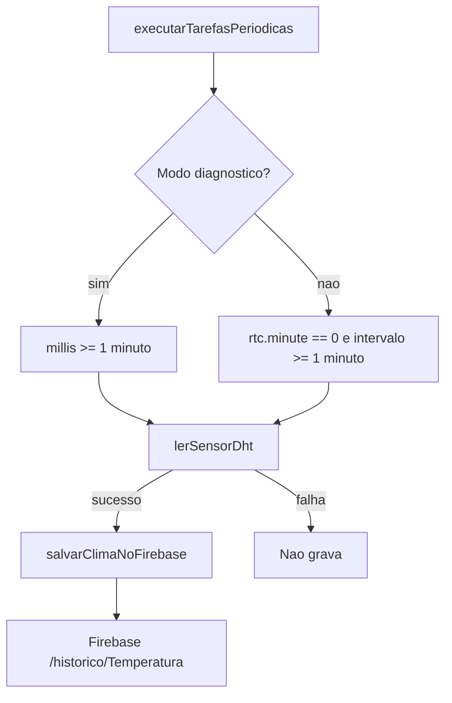
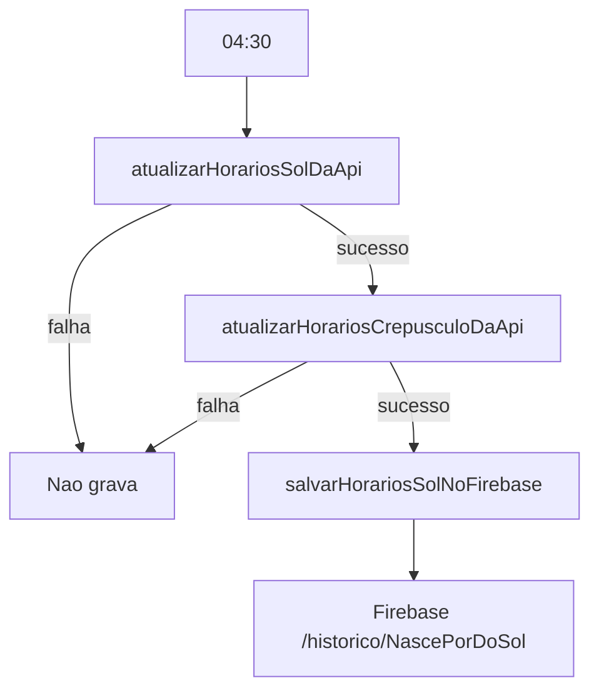
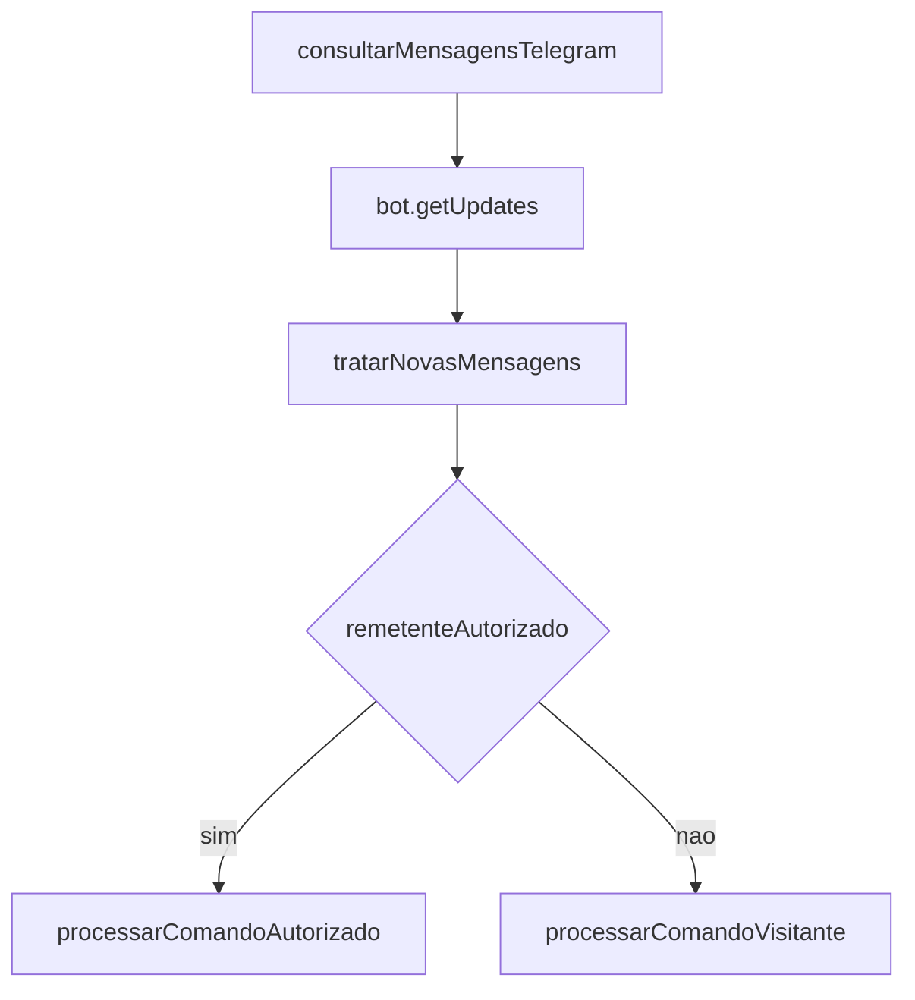

# Architecture AI

## Visao Geral

Sistema embarcado Arduino/ESP32 para uma estacao climatica. O firmware coleta temperatura, umidade e sensacao termica de um DHT22, mantem data/hora com RTC DS3231 e NTP, calcula/consulta horarios solares por APIs externas, grava historico no Firebase Realtime Database e responde comandos via Telegram.

O objetivo observado no codigo e manter historico climatico e solar no Firebase e expor consultas por Telegram. Nao ha interface grafica embarcada, atuadores fisicos, display, SPI, Bluetooth ou armazenamento local declarado no sketch.

Usuarios identificados no codigo:

- Usuarios autorizados do Telegram, definidos por `VALID_SENDER_IDS` em `secrets.h`.
- Visitantes do Telegram, que nao estao em `VALID_SENDER_IDS`.

Problema resolvido pelo firmware:

- Automatizar coleta local de clima.
- Persistir historico horario no Firebase.
- Persistir dados solares diarios no Firebase.
- Responder consultas locais e por localizacao/CEP via Telegram.

## Estrutura Fisica

```text
estacao_climatica/
  estacao_climatica.ino
  01_Utils.ino
  02_Connectivity.ino
  03_Sensors.ino
  04_WeatherAndSun.ino
  05_Firebase.ino
  06_Telegram.ino
  07_Tasks.ino
  secrets.h
  docs/
    AI_QUICK_CONTEXT.md
    BUSINESS_RULES.md
    ARCHITECTURE_AI.md
    DEPENDENCY_MAP.md
    AI_SYSTEM_PROMPT.md
  .theia/
```

Responsabilidades:

- `estacao_climatica.ino`: arquivo principal do sketch; includes; macros de log; constantes; endpoints; comandos; structs; objetos globais; prototipos; `setup()`; `loop()`.
- `01_Utils.ino`: funcoes puras e auxiliares para tempo, formatacao, URL, validacao, mensagens, CEP e controle de chats aguardando localizacao.
- `02_Connectivity.ino`: Wi-Fi, clientes TLS, verificacao de conexao, RTC DS3231 e NTP.
- `03_Sensors.ino`: leitura DHT22 e atualizacao de `climaAtual`.
- `04_WeatherAndSun.ino`: chamadas OpenWeather e Sunrise-Sunset, parse JSON e conversao de horarios.
- `05_Firebase.ino`: inicializacao do Firebase e escrita em paths historicos.
- `06_Telegram.ino`: menus, mensagens, comandos autorizados/visitantes, CEP, localizacao e alerta.
- `07_Tasks.ino`: tarefas periodicas baseadas no RTC.
- `08_FirebaseQueue.ino`: outbox persistente FIFO no LittleFS.
- `secrets.h`: credenciais, IDs permitidos e localizacao padrao. Conteudo sensivel.
- `docs/`: base de conhecimento para IA e documentacao derivada do codigo real.
- `.theia/`: metadados de editor; nao participa do firmware.

Pastas `build-*` vistas durante diagnosticos sao saidas temporarias da Arduino CLI e nao fazem parte do codigo-fonte.

## Fluxo De Execucao

### Inicializacao

`setup()` executa:

1. `Wire.begin()`
2. `LOG_BEGIN(9600)` se `DEBUG_SERIAL` for `1`
3. `delay(1000)`
4. `dht.begin()`
5. `inicializarRtc()`
6. `conectarWifi()`
7. `clienteTempo.begin()`
8. `sincronizarRtcComNtp(true)`
9. `inicializarFirebase()`
10. `atualizarHorariosSolDaApi(localizacaoAtual)`
11. Se sol foi atualizado, `atualizarHorariosCrepusculoDaApi(localizacaoAtual)`
12. `lerSensorDht()`

### Loop

`loop()` executa sempre:

1. `conectarWifi()`
2. `sincronizarRtcComNtp()`
3. `executarTarefasPeriodicas()`
4. `consultarMensagensTelegram()`
5. Se `DEBUG_SERIAL`, `imprimirDiagnosticoSerial()`

## Componentes

### Configuracao Global

Arquivo: `estacao_climatica.ino`

Entradas:

- Valores de `secrets.h`.
- Constantes internas de pinos, intervalos e endpoints.

Saidas:

- Objetos globais configurados para sensor, Firebase, RTC, Wi-Fi, NTP e Telegram.

Dependencias:

- ArduinoJson, DHT, FirebaseESP32, HTTPClient, NTPClient, RTClib, UniversalTelegramBot, WiFi, WiFiClientSecure, WiFiUdp, Wire.

### DHT22

Arquivo: `03_Sensors.ino`

Responsabilidade:

- Ler umidade e temperatura no GPIO 4.
- Calcular sensacao termica.
- Atualizar `climaAtual`.

Entradas:

- Sensor DHT22.

Saidas:

- `climaAtual.temperatura`
- `climaAtual.umidade`
- `climaAtual.sensacaoTermica`
- retorno booleano de sucesso/falha.

### RTC/NTP/Wi-Fi

Arquivo: `02_Connectivity.ino`

Responsabilidades:

- Configurar certificados/cliente TLS.
- Conectar Wi-Fi.
- Iniciar RTC DS3231.
- Sincronizar RTC via NTP.

Entradas:

- `WIFI_SSID`, `WIFI_PASSWORD`.
- NTP server `pool.ntp.org`.
- RTC DS3231 via I2C.

Saidas:

- `WiFi.status()`.
- RTC ajustado por compilacao ou NTP.
- `ultimaSincroniaNtpMs`.

Risco:

- Se `rtc.begin()` falhar, o firmware entra em `while(true)` com `delay(1000)`.

### APIs Climaticas E Solares

Arquivo: `04_WeatherAndSun.ino`

Responsabilidades:

- Consultar OpenWeather para clima, sunrise, sunset e timezone.
- Consultar Sunrise-Sunset para `astronomical_twilight_begin`, `solar_noon` e `astronomical_twilight_end`.
- Converter timestamps UTC ou ISO UTC para horario local usando timezone da coordenada.

Entradas:

- `Localizacao`.
- `OPENWEATHER_API_KEY`.
- Wi-Fi conectado.

Saidas:

- `LeituraClima`.
- `HorariosSol`.
- `HorariosCrepusculo`.

### Firebase

Arquivo: `05_Firebase.ino`

Responsabilidades:

- Inicializar Firebase com URL e token legado.
- Gravar horarios solares.
- Gravar leituras de clima.

Entradas:

- `FIREBASE_HOST`
- `FIREBASE_AUTH`
- `climaAtual`
- `horariosSolHoje`
- `horariosCrepusculoHoje`
- `rtc.now()`

Saidas:

- Escritas no Realtime Database:
  - `/historico/Temperatura/DD-MM-AAAA/HH-MM/id`
  - `/historico/NascePorDoSol/DD-MM-AAAA/id`

Observacao:

- O codigo usa `Firebase.setJSON()` sincrono em IDs deterministas para evitar duplicatas por timeout.
- Falhas ficam em uma fila FIFO em LittleFS; `08_FirebaseQueue.ino` envia um registro por tentativa, com backoff de 5 s a 5 min.
- Cada arquivo guarda tipo, destino, JSON, timestamp original, ID e metodo. Arquivo temporario e renomeado para confirmar a gravacao local; na inicializacao, um temporario valido e recuperado e um incompleto e preservado sem sobrescrita.
- A fila limita uso a 256 KiB (particao `spiffs` padrao: 1.375 MiB). Ao lotar, preserva pendencias antigas, rejeita o novo registro e emite erro serial.
- Na primeira inicializacao, uma particao sem filesystem e formatada para criar a fila; depois disso o marcador NVS impede formatacao automatica em caso de falha de montagem.

### Telegram

Arquivo: `06_Telegram.ino`

Responsabilidades:

- Polling de mensagens.
- Separar usuarios autorizados e visitantes.
- Responder comandos.
- Solicitar localizacao via teclado Telegram.
- Consultar por CEP via Nominatim.
- Enviar alerta diario alguns minutos depois do amanhecer.

Entradas:

- Mensagens Telegram.
- `VALID_SENDER_IDS`.
- Dados atuais de clima e sol.

Saidas:

- Mensagens HTML enviadas pelo bot.

### Tarefas Periodicas

Arquivo: `07_Tasks.ino`

Responsabilidades:

- Gravar clima na hora cheia.
- Em modo diagnostico, gravar clima a cada minuto.
- Atualizar e gravar dados solares uma vez ao dia as 04:30.
- Enviar alerta alguns minutos depois do amanhecer, somente com horarios de crepusculo validos.

Entradas:

- `rtc.now()`
- `millis()`
- constantes de horario/intervalo.

Saidas:

- Chamadas para Firebase e Telegram.

## Fluxo De Dados

```text
DHT22 -> lerSensorDht() -> climaAtual -> salvarClimaNoFirebase() -> Firebase /historico/Temperatura
RTC/NTP -> rtc.now() -> paths Firebase, tarefas periodicas, mensagens Telegram
OpenWeather -> atualizarHorariosSolDaApi() -> horariosSolHoje -> Firebase/Telegram
Sunrise-Sunset -> atualizarHorariosCrepusculoDaApi() -> horariosCrepusculoHoje -> Firebase
Telegram usuario -> consultarMensagensTelegram() -> comandos -> APIs/sensores -> resposta Telegram
Nominatim CEP -> primeira lat/lon encontrada -> OpenWeather -> resposta Telegram aproximada
```

## APIs

### OpenWeather

Endpoint base no codigo:

```text
https://api.openweathermap.org/data/2.5/weather?lat=
```

URL montada:

```text
lat, lon, appid
```

Campos lidos:

- `main.temp`
- `main.humidity`
- `main.feels_like`
- `sys.sunrise`
- `sys.sunset`
- `timezone`

Temperaturas sao convertidas de Kelvin para Celsius subtraindo `273.15`.

### Sunrise-Sunset

Endpoint base:

```text
https://api.sunrise-sunset.org/json
```

Parametros:

- `lat`
- `lng`
- `date`
- `formatted=0`

Campos lidos:

- `status`
- `results.astronomical_twilight_begin`
- `results.solar_noon`
- `results.astronomical_twilight_end`

### Nominatim/OpenStreetMap

Endpoint base:

```text
https://nominatim.openstreetmap.org/search?format=json&countrycodes=br&limit=1&postalcode=
```

Header:

```text
User-Agent: EstacaoClimaticaESP32/1.0
```

Campos lidos:

- `[0].lat`
- `[0].lon`

Comportamento real no firmware:

- `ehComandoCep()` aceita texto com 8 digitos, com ou sem hifen.
- `tratarComandoCep()` envia o CEP como parametro `postalcode`.
- O firmware usa somente o primeiro resultado (`doc[0]`) do Nominatim.
- O firmware exige apenas `lat` e `lon`; nao valida `postcode`, cidade, UF, `display_name`, `class`, `type` ou nivel de precisao.
- A coordenada retornada por CEP pode representar rua, bairro, cidade ou outro centroide aproximado.
- Quando o usuario compartilha localizacao pelo Telegram, essa coordenada tende a ser mais precisa que a consulta por CEP.
- Se o Nominatim nao retornar resultado ou nao retornar `lat/lon`, o bot pede para tentar outro CEP ou compartilhar localizacao.

### NTP

Servidor:

```text
pool.ntp.org
```

Usado por `NTPClient`.

## Firebase

Tipo usado: Realtime Database.

Inicializacao:

- `configFirebase.database_url = FIREBASE_HOST`
- `configFirebase.signer.tokens.legacy_token = FIREBASE_AUTH`
- `Firebase.reconnectNetwork(true)`
- `dadosFirebase.setBSSLBufferSize(4096, 1024)`
- `Firebase.begin(&configFirebase, &authFirebase)`

Paths escritos:

```text
/historico/Temperatura/DD-MM-AAAA/HH-MM/clima
/historico/NascePorDoSol/DD-MM-AAAA/solar
```

Campos de `Temperatura`:

- `Temperatura`
- `Umidade`
- `Sensacao termica`

Campos de `NascePorDoSol`:

- `HoraPorDoSol`
- `MinutePorDoSol`
- `HourNascerDoSol`
- `MinuteNascerDoSol`
- `HoraAmanhecer`
- `MinuteAmanhecer`
- `HoraZenite`
- `MinuteZenite`
- `HourAnoitecer`
- `MinuteAnoitecer`

## Configuracoes

Constantes principais:

- `DHT_PIN = 4`
- `DHT_TYPE = DHT22`
- `DESLOCAMENTO_FUSO_SEGUNDOS = -3 * 3600`
- `INTERVALO_CONSULTA_TELEGRAM_MS = 1000`
- `UM_MINUTO_MS = 60000`
- `MODO_DIAGNOSTICO_FIREBASE = false`
- `INTERVALO_SINCRONIA_NTP_MS = 10 * UM_MINUTO_MS`
- `TEMPO_LIMITE_CONEXAO_WIFI_MS = 15000`
- `INTERVALO_TENTATIVA_WIFI_MS = 30000`
- `TEMPO_LIMITE_HTTP_MS = 5000`
- `HORA_ATUALIZACAO_SOL_DIARIA = 4`
- `MINUTO_ATUALIZACAO_SOL_DIARIA = 30`
- `MINUTOS_APOS_AMANHECER_ALERTA = 15`
- `TAMANHO_BUFFER_URL = 220`
- `MAX_CHATS_AGUARDANDO_LOCALIZACAO = 5`

`secrets.h` contem:

- Wi-Fi SSID e senha.
- OpenWeather API key.
- Telegram bot token.
- IDs Telegram autorizados.
- Firebase host e token.
- Latitude, longitude e altitude padrao.

## Graficos

Nao ha graficos no projeto Arduino. O firmware grava dados que podem ser consumidos por outro projeto.

## Eventos

- Polling Telegram a cada `INTERVALO_CONSULTA_TELEGRAM_MS`.
- Sincronia NTP a cada `INTERVALO_SINCRONIA_NTP_MS`.
- Gravacao de clima na hora cheia.
- Atualizacao solar diaria as 04:30.
- Alerta diario alguns minutos depois do amanhecer, uma vez por data.

## Fluxos Criticos

### Clima Horario



### Solar Diario



### Telegram



## Arquivos Mais Importantes

1. `estacao_climatica.ino`
2. `01_Utils.ino`
3. `02_Connectivity.ino`
4. `03_Sensors.ino`
5. `04_WeatherAndSun.ino`
6. `05_Firebase.ino`
7. `06_Telegram.ino`
8. `07_Tasks.ino`
9. `secrets.h`

Nao ha 20 arquivos-fonte no projeto; todos os arquivos relevantes foram listados.

## Arquivos Complexos

- `06_Telegram.ino`: maior numero de fluxos condicionais, permissao e estados por chat.
- `04_WeatherAndSun.ino`: depende de duas APIs, timezone e parse JSON.
- `07_Tasks.ino`: coordena horario, millis e acoes de escrita/alerta.
- `05_Firebase.ino`: contrato externo de dados; alteracoes podem quebrar consumidores.

## Mapa Para IA

- Antes de alterar Firebase: leia `05_Firebase.ino`, `07_Tasks.ino`, structs em `estacao_climatica.ino`.
- Antes de alterar Telegram: leia `06_Telegram.ino` e validadores em `01_Utils.ino`.
- Antes de alterar sensores: leia `03_Sensors.ino`, constantes em `estacao_climatica.ino`, regras em `07_Tasks.ino`.
- Antes de alterar sol/fuso: leia `04_WeatherAndSun.ino` e funcoes de tempo em `01_Utils.ino`.
- Antes de alterar Wi-Fi/TLS/NTP: leia `02_Connectivity.ino`.

## Riscos Tecnicos

- Uso de `String` em ESP32 e Telegram/Firebase/HTTP pode fragmentar heap em execucao longa.
- `clienteHttps.setInsecure()` usa TLS sem validacao de certificado.
- Ausencia de RTC trava o firmware.
- `Firebase.setJSON()` e sincrono e pode bloquear durante timeout; so um item de fila e tentado por intervalo.
- Sketch usa 97% de flash no build com fila Firebase; restam cerca de 27 KiB na particao de app selecionada.
- `build-*` deve ser tratado como saida temporaria, nao codigo.

## Compilacao Observada

Comando executado:

```text
arduino-cli compile --fqbn esp32:esp32:esp32 --build-path .\build-doc-check .
```

Resultado:

```text
Sketch uses 1283533 bytes (97%) of program storage space.
Global variables use 49788 bytes (15%) of dynamic memory.
```

## Resumo Executivo

O projeto e um firmware ESP32 modular, sem framework web local, focado em coleta climatica, calculo/consulta solar, Telegram e Firebase. O ponto de maior acoplamento externo e o contrato Firebase. O ponto de maior complexidade interna e o fluxo Telegram. O ponto de maior risco operacional e a dependencia obrigatoria do RTC DS3231 durante boot.
