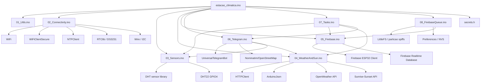
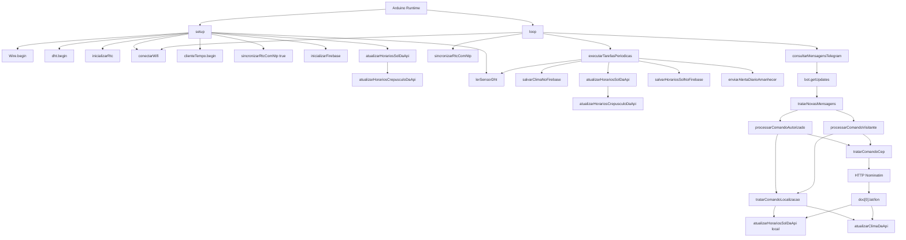

# Dependency Map

## Diagrama Geral

## Modulo: estacao_climatica.ino

Responsabilidade:

- Agregar includes, constantes, endpoints, comandos, structs, objetos globais, prototipos, `setup()` e `loop()`.

Dependencias Diretas:

- `secrets.h`
- ArduinoJson
- DHT
- FirebaseESP32
- HTTPClient
- NTPClient
- RTClib
- UniversalTelegramBot
- WiFi
- WiFiClientSecure
- WiFiUdp
- Wire
- Todas as abas `.ino`.

Dependencias Indiretas:

- DHT22
- DS3231
- Firebase Realtime Database
- Telegram API
- OpenWeather
- Sunrise-Sunset
- Nominatim
- NTP

Quem chama:

- Runtime Arduino chama `setup()` e `loop()`.

Quem e chamado:

- `conectarWifi`
- `inicializarRtc`
- `sincronizarRtcComNtp`
- `inicializarFirebase`
- `atualizarHorariosSolDaApi`
- `atualizarHorariosCrepusculoDaApi`
- `lerSensorDht`
- `executarTarefasPeriodicas`
- `consultarMensagensTelegram`

Impacto da alteracao:

- Critico. Mudancas podem afetar boot, objetos globais, pinos, endpoints e assinatura de funcoes.

## Modulo: 01_Utils.ino

Responsabilidade:

- Funcoes auxiliares de tempo, formatacao, URL, validacao de leitura, validacao de CEP, validacao de localizacao e controle de chats aguardando localizacao.

Dependencias Diretas:

- `rtc`
- `bot`
- `VALID_SENDER_IDS`
- `URL_OPENWEATHER`
- `URL_BUSCA_OPENSTREETMAP`
- `URL_SUNRISE_SUNSET`
- `OPENWEATHER_API_KEY`
- structs `Localizacao` e `LeituraClima`

Dependencias Indiretas:

- Telegram message model.
- Firebase path format.
- API URL format.

Quem chama:

- `04_WeatherAndSun.ino`
- `05_Firebase.ino`
- `06_Telegram.ino`
- `07_Tasks.ino`
- `estacao_climatica.ino` em diagnostico.

Quem e chamado:

- Funcoes internas nao chamam modulos externos de rede; manipulam estado e strings.

Impacto da alteracao:

- Alto. Pode quebrar formatacao de datas, paths Firebase, URLs, permissoes e localizacao.

## Modulo: 02_Connectivity.ino

Responsabilidade:

- Wi-Fi, clientes TLS, RTC DS3231, NTP.

Dependencias Diretas:

- `WiFi`
- `WiFiClientSecure`
- `RTClib`
- `NTPClient`
- `WIFI_SSID`
- `WIFI_PASSWORD`
- `TELEGRAM_CERTIFICATE_ROOT`

Dependencias Indiretas:

- Telegram depende de `clienteSeguro`.
- APIs HTTPS dependem de `clienteHttps`.
- Firebase depende de rede.
- Tarefas dependem de `rtc.now()`.

Quem chama:

- `setup()`
- `loop()`
- funcoes que checam `wifiConectado()`.

Quem e chamado:

- `WiFi.begin`
- `WiFi.status`
- `rtc.begin`
- `rtc.adjust`
- `clienteTempo.update`

Impacto da alteracao:

- Critico. Pode impedir rede, horario e inicializacao geral.

## Modulo: 03_Sensors.ino

Responsabilidade:

- Ler DHT22, rejeitar NaN, calcular sensacao termica e atualizar `climaAtual`.

Dependencias Diretas:

- `dht`
- `climaAtual`

Dependencias Indiretas:

- Firebase clima.
- Telegram clima/status/alerta.

Quem chama:

- `setup()`
- `processarComandoAutorizado()`
- `executarTarefasPeriodicas()`

Quem e chamado:

- `dht.readHumidity`
- `dht.readTemperature`
- `dht.computeHeatIndex`

Impacto da alteracao:

- Medio. Pode afetar valores gravados e respostas Telegram.

## Modulo: 04_WeatherAndSun.ino

Responsabilidade:

- Consultar OpenWeather e Sunrise-Sunset.
- Parsear JSON.
- Atualizar clima externo, horarios solares e crepusculo/zenite.

Dependencias Diretas:

- `HTTPClient`
- `ArduinoJson`
- `clienteHttps`
- `wifiConectado`
- `montarUrlOpenWeather`
- `montarUrlSunriseSunset`
- `interpretarHorarioIsoUtcComFuso`
- `atribuirHorarioLocalDeTimestampUtc`
- `horariosSolHoje`
- `horariosCrepusculoHoje`

Dependencias Indiretas:

- OpenWeather API.
- Sunrise-Sunset API.
- Firebase solar.
- Telegram localizacao/CEP.

Quem chama:

- `setup()`
- `executarTarefasPeriodicas()`
- `tratarComandoLocalizacao()`
- `tratarComandoCep()`

Quem e chamado:

- `http.GET`
- `deserializeJson`

Impacto da alteracao:

- Alto. Pode quebrar fuso horario, dados solares, Telegram por localizacao e Firebase solar.

## Modulo: 05_Firebase.ino

Responsabilidade:

- Inicializar Firebase e gravar JSON.

Dependencias Diretas:

- `FirebaseESP32`
- `FirebaseData`
- `FirebaseAuth`
- `FirebaseConfig`
- `FIREBASE_HOST`
- `FIREBASE_AUTH`
- `wifiConectado`
- `rtc`
- `climaAtual`
- `horariosSolHoje`
- `horariosCrepusculoHoje`

Dependencias Indiretas:

- Consumidores externos do Firebase.

Quem chama:

- `setup()`
- `executarTarefasPeriodicas()`

Quem e chamado:

- `Firebase.begin`
- `Firebase.ready`
- `Firebase.setJSON`
- `LittleFS` e `Preferences`

Impacto da alteracao:

- Critico. Mudancas em paths/campos quebram historico e consumidores externos.

## Modulo: 08_FirebaseQueue.ino

Responsabilidade:

- Persistir gravacoes Firebase pendentes em arquivos LittleFS e reenviar em ordem FIFO.
- Remover cada arquivo somente apos confirmacao do `setJSON` idempotente.
- Aplicar backoff exponencial limitado a 5 minutos.

Dependencias diretas:

- `LittleFS`, `Preferences`, `ArduinoJson` e funcoes de envio de `05_Firebase.ino`.

Limites:

- Maximo 256 KiB da particao `spiffs` padrao de 1.375 MiB.
- Arquivo temporario e renomeado no commit local; na inicializacao, temporario valido e recuperado e um incompleto e preservado sem sobrescrita.
- Particao marcada como inicializada nao e formatada automaticamente se falhar a montagem.
- Na primeira inicializacao, LittleFS pode formatar a particao nova `spiffs`; nao use nela dados de outro sistema sem backup.
- Se a fila lotar ou o FS falhar, itens antigos ficam intactos; novo item e reportado como erro critico serial.

## Modulo: 06_Telegram.ino

Responsabilidade:

- Interacao com Telegram, comandos, menus, visitantes/autorizados, localizacao e CEP.

Dependencias Diretas:

- `UniversalTelegramBot`
- `remetenteAutorizado`
- `ehComandoCep`
- `ehMensagemLocalizacaoBruta`
- `atualizarHorariosSolDaApi`
- `atualizarClimaDaApi`
- `lerSensorDht`
- `montarMensagemClima`
- `clienteHttps`
- Nominatim API

Dependencias Indiretas:

- OpenWeather.
- Firebase nao e chamado diretamente em comandos Telegram.
- Estado de localizacao em `chatsAguardandoLocalizacao`.

Quem chama:

- `loop()` via `consultarMensagensTelegram()`.
- `executarTarefasPeriodicas()` chama `enviarAlertaDiarioAmanhecer()`.

Quem e chamado:

- `bot.getUpdates`
- `bot.sendMessage`
- `bot.sendMessageWithReplyKeyboard`
- `HTTPClient` para CEP

Impacto da alteracao:

- Alto. Pode bloquear usuarios, localizacao, CEP e alertas.

## Modulo: 07_Tasks.ino

Responsabilidade:

- Orquestrar tarefas periodicas por RTC e `millis()`.

Dependencias Diretas:

- `rtc`
- `millis`
- `lerSensorDht`
- `salvarClimaNoFirebase`
- `atualizarHorariosSolDaApi`
- `atualizarHorariosCrepusculoDaApi`
- `salvarHorariosSolNoFirebase`
- `enviarAlertaDiarioAmanhecer`

Dependencias Indiretas:

- DHT22
- Firebase
- OpenWeather
- Sunrise-Sunset
- Telegram

Quem chama:

- `loop()`

Quem e chamado:

- Modulos de sensores, API, Firebase e Telegram.

Impacto da alteracao:

- Alto. Pode mudar frequencia de gravacao e alertas.

## Modulo: secrets.h

Responsabilidade:

- Guardar credenciais e configuracoes sensiveis.

Dependencias Diretas:

- Nenhuma no proprio arquivo.

Dependencias Indiretas:

- Todos os modulos que usam Wi-Fi, API, Telegram, Firebase e localizacao.

Quem chama:

- `estacao_climatica.ino` inclui `secrets.h`.

Quem e chamado:

- Nao chama funcoes.

Impacto da alteracao:

- Critico. Valores incorretos impedem rede, APIs, Telegram, Firebase ou localizacao padrao.

## Bibliotecas Usadas Pelo Sketch

Compilacao observada carregou:

- ArduinoJson 7.4.3
- DHT sensor library 1.4.7
- Firebase ESP32 Client 4.4.17
- LittleFS 2.0.0
- Preferences (incluida no ESP32 core)
- FS 2.0.0
- SD 2.0.0
- SPI 2.0.0
- WiFi 2.0.0
- Update 2.0.0
- HTTPClient 2.0.0
- WiFiClientSecure 2.0.0
- NTPClient 3.2.1
- RTClib 2.1.4
- Adafruit BusIO 1.17.4
- Wire 2.0.0
- UniversalTelegramBot 1.3.0
- Adafruit Unified Sensor 1.1.15

## Call Graph

## Observacao Sobre CEP

O fluxo de CEP no firmware e uma geocodificacao aproximada:

- `ehComandoCep()` aceita 8 digitos, com ou sem hifen.
- `tratarComandoCep()` chama Nominatim com `postalcode`.
- O firmware usa o primeiro resultado retornado (`doc[0]`).
- Somente `lat` e `lon` sao obrigatorios no parse atual.
- Nao ha validacao de cidade, UF, `postcode`, `display_name`, `class`, `type` ou precisao.
- A coordenada compartilhada pelo Telegram e o caminho mais preciso quando o usuario quer clima de uma posicao especifica.
